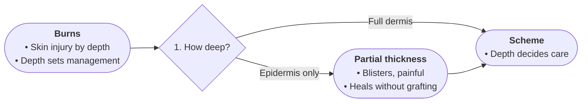

# Profile: classification

For taxonomy text: sorting items into named categories by stated criteria.
Boards grammar: discriminate step by step — broad splits before fine ones.

- START names what is being classified and its domain, 2–4 bullets.
- Diamonds are distinguishing criteria the source states, numbered broad to specific.
- Edge labels name the criterion value leading to each category.
- Bullets carry defining features, typical members, boundary notes. No invented members.
- Each fact once; the scheme summary closes the chart; TAKE states it in one line.

