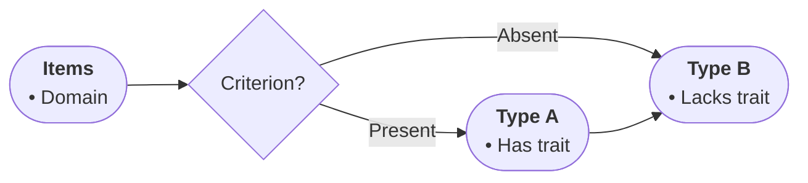

# Profile: classification (DRAFT — table never arrived; correct me)

For taxonomy text: sorting items into named categories by criteria.

- Node roles: START names what is being classified; steps are sorting stages; outputs are the categories; TAKE is the scheme summary.
- Diamonds mean a distinguishing criterion the source states.
- Edge labels name the criterion value leading to each category.
- Bullets: defining features, typical members, boundary notes.

