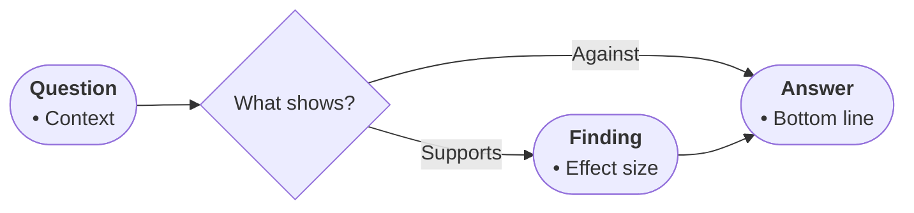

# Profile: evidence (DRAFT — table never arrived; correct me)

For findings text: claims weighed against supporting evidence.

- Node roles: START states the question; steps are observations or trials; outputs are conclusions; TAKE is the bottom line.
- Diamonds mean a fork the evidence forces (effect vs no effect, competing interpretations).
- Edge labels name the inference (supports / contradicts / inconclusive).
- Bullets: findings with magnitudes, samples, conditions; keep uncertainty words.

