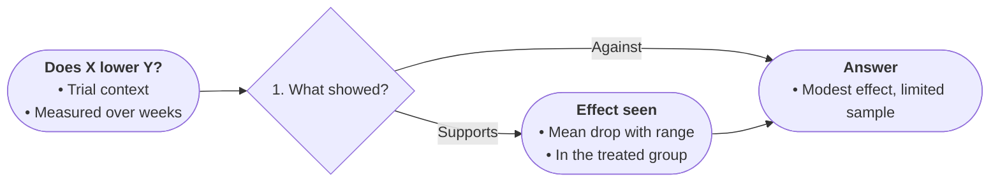

# Profile: evidence

For findings text: claims weighed against supporting evidence.
Boards grammar: every finding traces to its sentence; certainty never upgrades.

- START states the question and its context, 2–4 bullets.
- Diamonds are forks the evidence forces (effect vs no effect, rival readings), numbered broad to specific.
- Edge labels name the inference the source supports (supports / contradicts / inconclusive).
- Bullets carry findings with magnitudes, samples, and conditions. Keep every uncertainty word; numbers exactly.
- Each fact once; the bottom line closes the chart; TAKE states it in one line.

