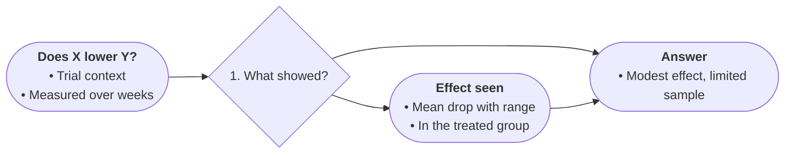

# Profile: evidence

For findings text: claims weighed against supporting evidence.
Boards grammar: every finding traces to its sentence; certainty never upgrades.

- START states the question and its context, 2–4 bullets.
- Diamonds are questions the evidence forces (effect vs no effect, rival readings), numbered broad to specific. Diamonds carry no finding bullets. Use a diamond only where the source states distinct routing conditions; otherwise lay the paths out in parallel without a diamond.
- Edge labels quote the source-stated routing condition (group names, criterion values). Never use inference labels (supports / contradicts / inconclusive). Every diamond exit needs its label: unlabeled diamond exits fail validation.
- Findings go on result nodes with magnitudes, samples, and conditions. Overall findings get their own result node, never the diamond. Keep every uncertainty word; numbers exactly. See the WRITER branch-first scan.
- Each fact once; the bottom line closes the chart; TAKE states it in one line.

