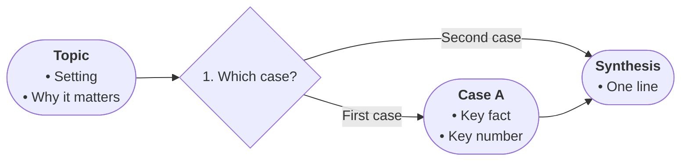

# Profile: general

Fallback for expository text that fits no other profile.
Boards grammar applies unchanged: frame, fork, route, conclude — each fact once.

- START frames the topic and its setting, 2–4 bullets.
- Diamonds only for explicit comparisons or choices the source states, numbered broad to specific.
- Edge labels name the relation the source supports (leads to / contrasts with / for example).
- Bullets carry key facts with numbers and hedges kept exactly as written.
- Each fact once; the synthesis closes the chart; TAKE states it in one line.

