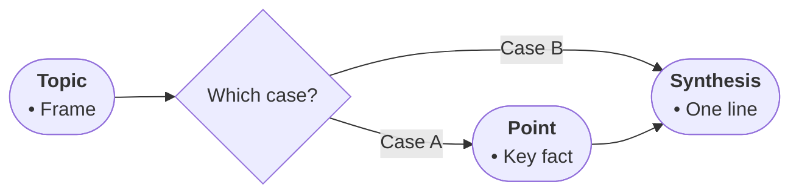

# Profile: general (DRAFT — table never arrived; correct me)

Fallback for expository text that fits no other profile.

- Node roles: START frames the topic; steps are key points in source order; outputs are results; TAKE is the one-line synthesis.
- Diamonds only for explicit comparisons or choices the source states.
- Edge labels name the relation (leads to / contrasts / for example).
- Bullets: key facts with numbers and hedges kept verbatim in spirit.

