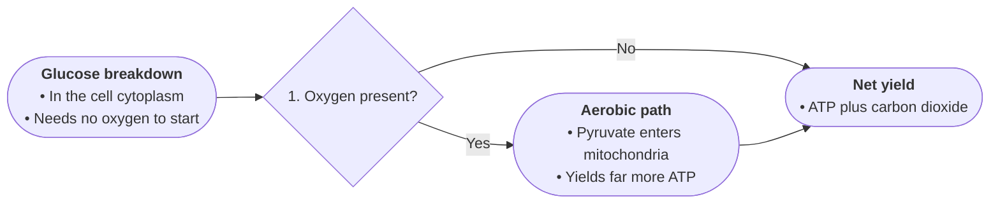

# Profile: mechanism

For how-it-works text: causal chains where each stage enables the next.
Boards grammar: the discriminating pathway — each fork routes on a stated trigger.

- START names the system and its setting in source terms, 2–4 bullets.
- Diamonds are alternative pathways the source states (light vs dark, aerobic vs anaerobic), numbered broad to specific.
- Edge labels name the trigger or condition routing flow down that path.
- Stage bullets carry entities, inputs consumed, outputs released, locations. Keep hedges; numbers exactly.
- Each fact once; the net effect closes the chart; TAKE states it in one line.

