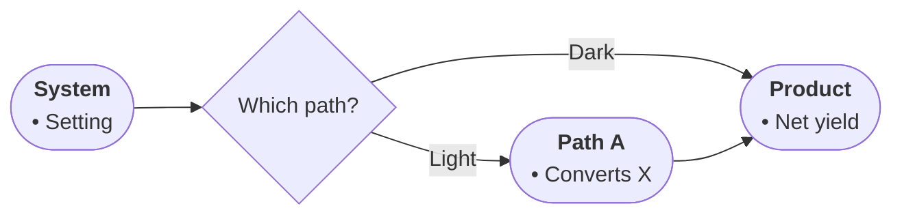

# Profile: mechanism (DRAFT — table never arrived; correct me)

For how-it-works text: causal chains where each stage enables the next.

- Node roles: START names the system; steps are causal stages; outputs are products; TAKE is the net effect.
- Diamonds mean alternative pathways the source states (e.g. light vs dark, aerobic vs anaerobic).
- Edge labels name the trigger or condition routing flow down a path.
- Bullets: entities, inputs consumed, outputs released, locations.

