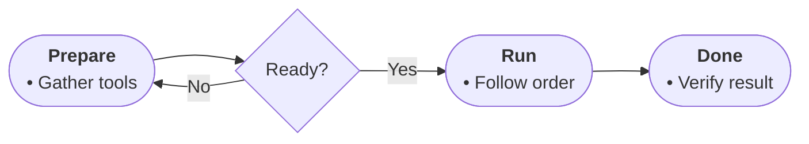

# Profile: procedure (DRAFT — table never arrived; correct me)

For how-to text: ordered steps that transform an input into an outcome.

- Node roles: START frames the task; steps are actions in order; outputs are results; TAKE is the done-state.
- Diamonds mean a check or condition the source states (ready? valid? complete?); never invent a check.
- Edge labels name the condition outcome (Yes / No / the named state).
- Bullets: the action detail — who acts, with what, how much, how long.

