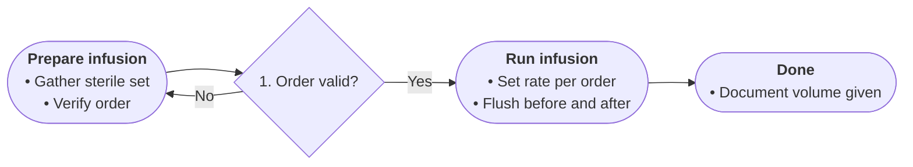

# Profile: procedure

For how-to text: ordered actions that transform an input into an outcome.
Boards grammar: a resident's walkthrough — present, check, act, confirm.

- START frames the task and its starting state in source terms, 2–4 bullets.
- Diamonds are readiness or validity checks the source states, numbered broad to specific. Never invent a check.
- Edge labels name the check outcome (Yes / No / the named state).
- Step bullets carry the action detail: who acts, with what, how much, how long. Thresholds and numbers exactly as written.
- Each fact once; the done-state closes the chart; TAKE names it in one line.

