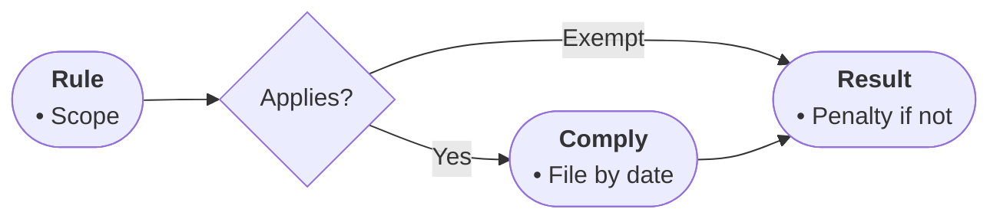

# Profile: rules (DRAFT — table never arrived; correct me)

For normative text: who must do what, by when, and what happens otherwise.

- Node roles: START names the rule system; steps are duties in order; outputs are outcomes or penalties; TAKE is the compliance summary.
- Diamonds mean applicability conditions and exceptions the source states.
- Edge labels name if-applies / if-exempt outcomes.
- Bullets: actors, deadlines, amounts, filings, consequences.

